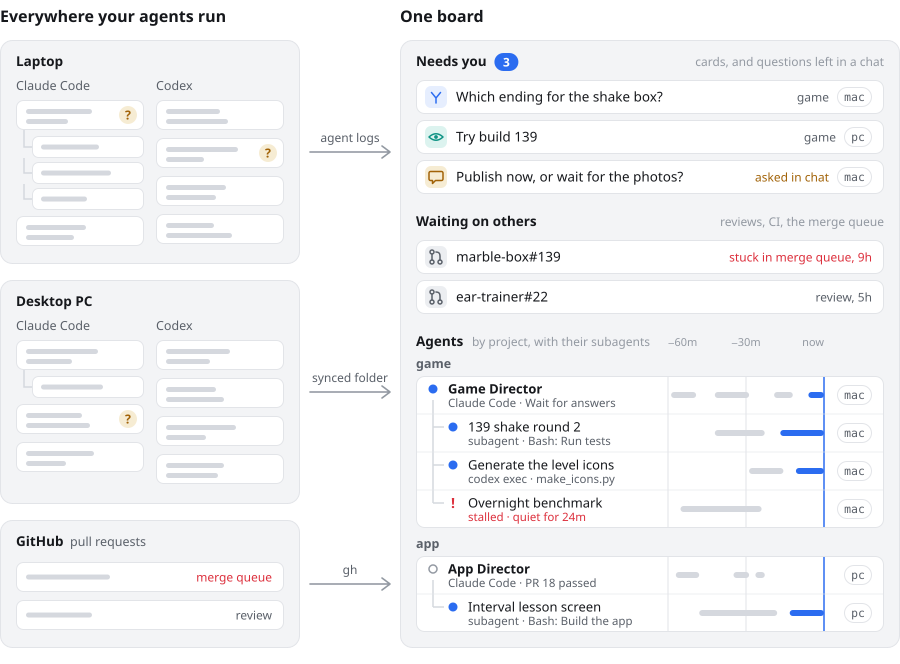
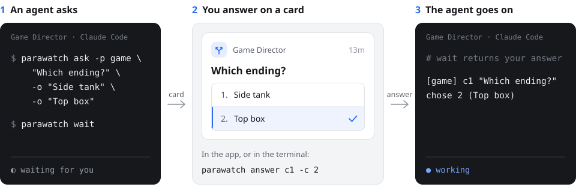
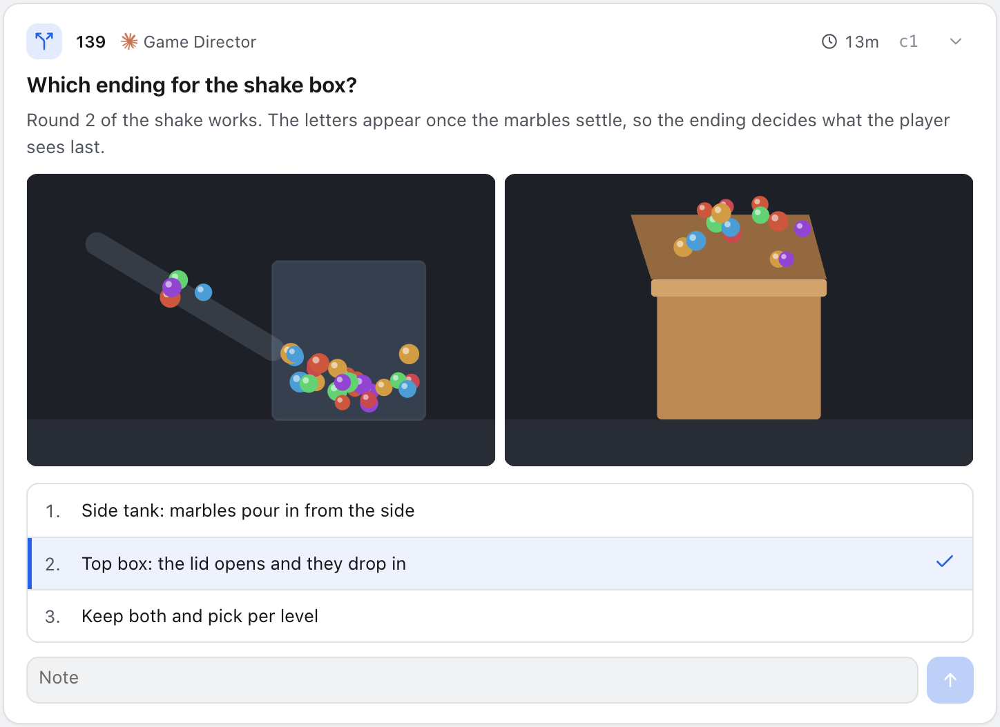
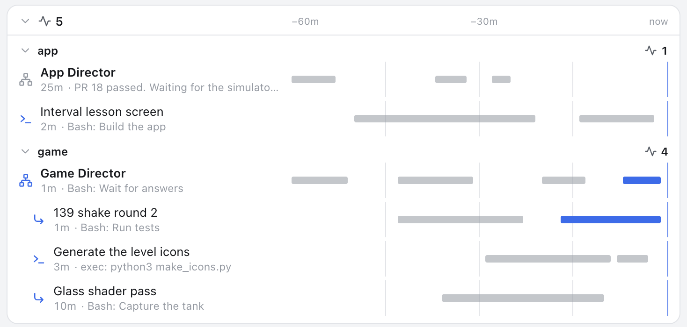

# parawatch

<p>
  <a href="README.md"></a>
  <a href="README.ko.md"></a>
</p>

Claude Code 와 Codex 세션을 여러 개, 때로는 여러 기기에서 돌리는 사람을 위한 도구입니다.

세션이 많아지면 어느 게 무슨 일이었는지, 각각 잘 돌고 있는지, 무엇을 물어 놓고 그 질문이 화면 밖으로 밀려났는지 알기 어려워집니다. parawatch 는 이 세션들을 한 보드에 모아 보여 줍니다.

<picture>
  <source media="(prefers-color-scheme: dark)" srcset="docs/env-dark.svg">
  
</picture>

| | |
|--|--|
| **어느 게 무슨 일인지** | 세션을 프로젝트와 작업별로 묶고, 그 아래 subagent 와 `codex exec` 작업, 각각이 도는 기기까지 보여 줍니다. |
| **잘 돌고 있는지** | 작업 중, 유휴, 멈춤, 실패 상태와 지금 하는 일, 지난 한 시간의 타임라인. |
| **나를 기다리는 일** | 질문이 카드로 옵니다. 채팅에 남긴 질문도 잡아냅니다. 답하면 물어본 에이전트에게 돌아갑니다. |
| **남을 기다리는 일** | 내 pull request 가 리뷰, CI, merge queue 중 무엇을 얼마나 기다리는지. |

macOS 와 Windows 용 CLI 와 데스크톱 앱입니다. 에이전트를 직접 띄우지 않고, 이미 돌리고 있는 에이전트의 로그를 읽습니다. 서버는 없습니다.

## 설치

```
npm install -g parawatch     # CLI, Node 20 이상
parawatch skill install      # Claude Code·Codex 에이전트가 프로토콜을 익힘
parawatch status             # 나를 기다리는 일, 그다음 돌고 있는 것
```

데스크톱 앱은 [최신 릴리스](https://github.com/penspanic/parawatch/releases/latest)에 있습니다. macOS 는 Apple silicon 용 `arm64`, Intel 용 `x64` 이고 서명·공증되어 있습니다. Windows 는 x64 용 `Parawatch-Setup-<version>.exe` 이며 서명되지 않아 처음 실행할 때 SmartScreen 이 경고합니다(추가 정보 > 실행). 둘 다 스스로 업데이트합니다.

| | macOS | Linux | Windows |
|--|--|--|--|
| CLI | 매일 사용 | CI 에서 테스트 통과 | 매일 사용 |
| 데스크톱 앱 | 매일 사용 | 아직 빌드 없음 | 0.3.9 부터 |
| 읽는 에이전트 로그 | Claude Code, Codex | 같음 | Claude Code, Codex |


## 여러 기기에서

parawatch 는 기기 사이에 파일을 옮기지 않습니다. 다른 도구(Syncthing, 클라우드 드라이브)가 맞춰 주는 폴더를 기기마다 한 번씩 지정합니다.

```
parawatch sync setup ~/agent-sync/parawatch --device mac --adapter syncthing
parawatch sync setup ~/agent-sync/parawatch --device pc  --adapter syncthing
```

그러면 카드, 답, 돌고 있는 세션 목록이 모든 기기에 보이고, 각각 어디서 왔는지 표시됩니다. 에이전트 로그는 그 로그를 쓴 기기에 남습니다. 자세한 내용은 [More than one machine](docs/sync.md).

직접 [relay](docs/relay.md) 를 돌릴 수도 있습니다. 폴더를 종단 간 암호화해 나르는 작은 서버라서, 서버는 카드나 세션을 읽을 수 없습니다. 첫 기기에서 `parawatch relay setup <url> <folder>`, 나머지 기기에서 `parawatch relay join <code> <folder>`. relay 를 쓰면 휴대폰에서도 카드에 답할 수 있습니다: [On a phone](docs/phone.md).

## 답이 돌아가는 길

<picture>
  <source media="(prefers-color-scheme: dark)" srcset="docs/flow-dark.svg">
  
</picture>

Claude Code 는 답하는 순간 깨어납니다. `parawatch wait` 가 세션의 백그라운드 명령으로 돌기 때문입니다. 다른 런타임은 다음 턴에 답을 읽습니다.


## 보이는 것

### 카드

<picture>
  <source media="(prefers-color-scheme: dark)" srcset="docs/card-dark.png">
  
</picture>

| 카드 | 에이전트가 여는 때 |
|--|--|
| `decide` | 선택지를 고르거나 답을 써야 할 때 |
| `try` | 빌드를 열거나 영상·화면을 봐야 할 때 |
| `block` | 나만 할 수 있고, 내가 할 때까지 에이전트가 멈춰 있을 때 |
| `todo` | 나만 할 수 있지만 지금 그걸 기다리는 일은 없을 때 |

### 에이전트

모든 세션과 그 subagent, `codex exec` 작업을 프로젝트별로 묶어 각각 지금 무엇을 하는지 보여 줍니다. 에이전트 자신의 로그에서 읽습니다.

<picture>
  <source media="(prefers-color-scheme: dark)" srcset="docs/agents-dark.png">
  
</picture>

### Pull request

이미 로그인해 둔 GitHub CLI 로 읽습니다. 열린 pull request 마다 무엇을(리뷰, CI, merge queue) 얼마나 기다리는지 보여 줍니다. 새 소식은 답처럼 그 PR 을 가진 세션을 깨웁니다. 누가 나에게 할당한 이슈는 나에게 온 리뷰 요청 옆에 보이고, 새로 할당되거나 누가 댓글을 달면 알림이 옵니다. 이슈는 에이전트를 깨우지 않습니다.

### 터미널에서

```
$ parawatch status
NEEDS YOU  4
  c1   decide   game/139   Which ending for the shake box?                12m
  c2   try      game/139   Try build 139: does the glass read as glass?    4m
  c3   blocked  app        Install the iPad simulator runtime              1h
  c7   decide   app/PR 21  Merge PR 21 and post the 1.4 release note?      9m

ASKED IN CHAT, NO CARD  1  (read from the log)
  Pricing page    6m  Publish it now, or wait for the new photos?  (site)

WAITING ON OTHERS  3 · 1 stuck
  marble-box#139  stuck in merge queue    9h  Game Director           Shake round 2 and the top-box ending
  ear-trainer#22  review (mina)           5h                          Settings screen
  ear-trainer#21  merge                  20m  Interval lesson screen  Interval lessons and the count-in

AGENTS  4 working
app
  ✓ Interval lesson screen (1 PR)    1m  done · PR 21 is green and reviewed; waiting on the merge
  ○ App Director                    24m  PR 18 passed. Waiting for the simulator runtime.
game
  ● Game Director (1 PR)             0s  Bash: Wait for answers
  ├ ● 139 shake round 2              0s  Bash: Run tests
  ├ ● Generate the level icons       2m  exec: python3 make_icons.py
  └ ! Overnight physics benchmark   24m  stalled · no sign of life for 24m · scene 5 of 8
site
  ○ Pricing page                     6m  asks: Publish it now, or wait for the new photos?
```

## 프로젝트 연결

```
parawatch init -f AGENTS.md -p game     # 또는 CLAUDE.md
```

그 프로젝트의 에이전트가 무슨 일을 하는지 밝히고, 카드로 묻고, `parawatch wait` 하나를 늘 걸어 두도록 하는 짧은 블록을 씁니다. 자세한 내용은 [Agents](docs/agents.md).

## 문서

문서는 영어로 되어 있습니다.

| | |
|--|--|
| [Commands](docs/commands.md) | 직접 쓰는 명령: `status`, `cards`, `answer`, `runs`, `pr`, `digest` |
| [Agents](docs/agents.md) | 프로토콜, skill, 세션이 깨어나는 방식, 다른 런타임 |
| [Pull requests](docs/pull-requests.md) | GitHub 에서 읽는 것과 설정 |
| [Observed agents](docs/observed-agents.md) | 읽는 로그, run 상태, 런타임 추가 |
| [More than one machine](docs/sync.md) | 동기화 폴더로 여러 기기에서 카드와 답 주고받기 |
| [The relay](docs/relay.md) | 공유 폴더를 종단 간 암호화해 나르는 내 서버 |
| [The shared folder](docs/protocol.md) | 기기끼리 주고받는 파일, 클라이언트를 만드는 사람용 |
| [Storage](docs/storage.md) | 모든 것이 저장되는 곳, 알림 |
| [Installing, updating, removing](docs/install.md) | 세 구성 요소 자세히, 업데이트, `parawatch doctor`, 제거 |
| [Building on it](docs/integrations.md) | `status --json`, `watch`, panel 패키지 |

## 하지 않는 것

- 에이전트를 띄우거나 조종하기. 쓰던 도구를 그대로 쓰면 되고, parawatch 는 지켜보고 답을 돌려줄 뿐입니다.
- 팀 공용 트래커. 한 사람과 그 사람의 에이전트를 위한 도구입니다. 다른 사람은 내 pull request 가 기다리는 리뷰어로만 보입니다.
- 이슈 트래커 대체. 카드는 금방 닫히는 질문이지 백로그가 아닙니다.

## 라이선스

MIT
