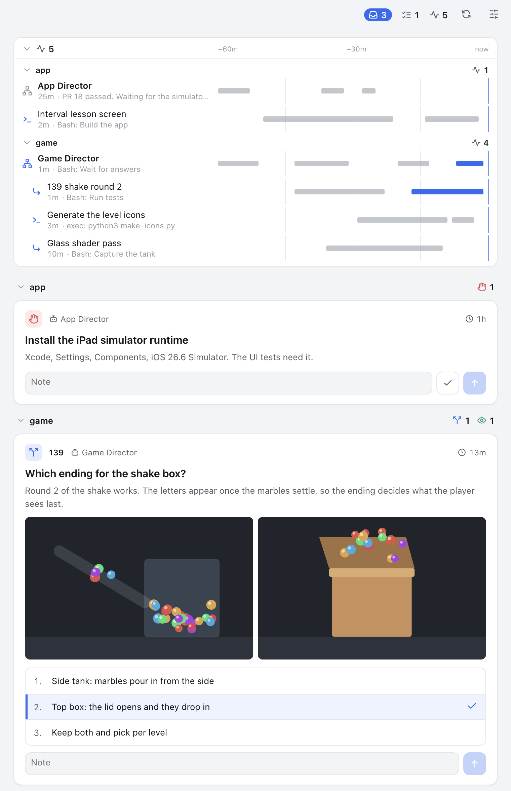

# parawatch

A control tower for people who run many AI coding agents at once, across several projects and several tasks inside each one.

<picture>
  <source media="(prefers-color-scheme: dark)" srcset="docs/app-dark.png">
  
</picture>

It answers three questions:

- **What needs me?** Decisions to make, builds or videos to try, things only you can do.
- **What is running?** Every agent session, its subagents and its `codex exec` jobs, grouped by project, with what each one is doing right now.
- **What waits on someone else?** Pull requests waiting on a review, CI or a merge queue, each next to the session that owns it, with how long it has waited.
- **Did my answer reach the agent?** When you answer a card, or a review lands on its pull request, the agent waiting on it wakes up. You do not go back to the chat to say "I decided" or "a review came in".

parawatch is a CLI first. Agents use the CLI, and so can you. There is no server. Agent logs and cards never leave your machine; the only thing read from outside is your pull requests, through the GitHub CLI you have already signed in, and only when you have it. On top of the CLI, this repository has a [desktop app](apps/desktop/README.md) (the panel above, a menu bar count, a Dock badge and notifications).

```
$ parawatch status
NEEDS YOU  4
  c1   decide   game/139   Which ending for the shake box?                12m
  c2   try      game/139   Try build 139: does the glass read as glass?    4m
  c3   blocked  app        Install the iPad simulator runtime              1h
  c7   decide   app/PR 21  Merge PR 21 and post the 1.4 release note?      9m

ASKED IN CHAT, NO CARD  1  (read from the log)
  Pricing page    6m  Publish it now, or wait for the new photos?  (site)

WAITING ON OTHERS  3 · 1 stuck
  marble-box#139  stuck in merge queue    9h  Game Director           Shake round 2 and the top-box ending
  ear-trainer#22  review (mina)           5h                          Settings screen
  ear-trainer#21  merge                  20m  Interval lesson screen  Interval lessons and the count-in

AGENTS  4 working
app
  ✓ Interval lesson screen (1 PR)    1m  done · PR 21 is green and reviewed; waiting on the merge
  ○ App Director                    24m  PR 18 passed. Waiting for the simulator runtime.
game
  ● Game Director (1 PR)             0s  Bash: Wait for answers
  ├ ● 139 shake round 2              0s  Bash: Run tests
  ├ ● Generate the level icons       2m  exec: python3 make_icons.py
  └ ! Overnight physics benchmark   24m  stalled · no sign of life for 24m · scene 5 of 8
site
  ○ Pricing page                     6m  asks: Publish it now, or wait for the new photos?
```

One line per item, always inside the terminal width. Finished subagents fold into a count after five minutes (`parawatch runs --all` shows them). `--wide` adds the runtime and ids. Colors follow `NO_COLOR` and `FORCE_COLOR`.

## Install

There are three parts. Most people want all three.

**The CLI**, which agents and you use:

```
npm install -g parawatch
```

**The agent skill**, so Claude Code and Codex agents learn the protocol on their own:

```
parawatch skill install
```

It links [`skills/parawatch`](skills/parawatch/SKILL.md) into `~/.claude/skills` and `~/.codex/skills`. The installed skill is a link to the copy in the package, so updating parawatch updates the skill.

**The desktop app**, to see and answer cards without a terminal. On macOS, download the DMG from the [latest release](https://github.com/penspanic/parawatch/releases/latest): `arm64` for Apple silicon, `x64` for Intel. It is signed and notarized, so it opens without warnings. From 0.2.1 on it updates itself: it downloads a new version in the background and asks you to restart (Parawatch > Check for Updates, or Settings > Update automatically). Elsewhere, [build it from source](apps/desktop/README.md#run-from-source).

**Checking the setup.** `parawatch doctor` shows the versions of the CLI and the app and whether they differ, the store, the skill links, the instruction files in this folder, the hook, and GitHub, with what to run for anything that needs work. Paste it into bug reports. `status` also says, at its end, when a newer CLI is out or when the app and the CLI are different versions.

### Updating and removing

```
npm install -g parawatch@latest     # the CLI; the linked skill follows it
```

The CLI asks the npm registry for the latest version at most once a day, only when you run `status` or `doctor` at a terminal. `"updates": { "check": false }` in `config.json` or `PARAWATCH_UPDATE_CHECK=0` turns that off; it is off in CI. The app looks at GitHub Releases every few hours unless you turn Update automatically off.

To remove parawatch:

```
parawatch skill uninstall           # the skill links
parawatch init --remove -f AGENTS.md   # the block in each instruction file you added it to
npm uninstall -g parawatch
```

Take the `parawatch hook` lines out of your Claude Code settings if you added them, drag Parawatch.app to the Trash, and delete `~/.local/state/parawatch` (your cards and history) and `~/Library/Logs/Parawatch` if you want those gone too.

### Platforms

| | macOS | Linux | Windows |
|--|--|--|--|
| CLI | used daily | tests pass in CI | not supported yet |
| Desktop app | used daily | untested | untested |
| Agent logs read | Claude Code, Codex | same | |

Node 20 or newer.

## Concepts

| | |
|--|--|
| **Project** | A name, and optionally one or more paths. Git worktrees of a path belong to the project too. |
| **Claim** | An agent session saying what it works on: a project, a task (a ticket key, a pull request, a short name), a title. It is the main way runs are grouped; guesses from the log are the fallback. A claim can also say the work is done. |
| **Card** | Something that needs the human. Four kinds: `decide` (pick an option or write an answer), `try` (open a build, watch a video, look at a screen), `block` (only the human can do it and the agent is stuck until they do: install, sudo, sign in), `todo` (only the human can do it, but nothing waits on it now: check a bill, register a company). A card remembers the session that opened it, and `--since` keeps when the matter first came up when it is older than the card. |
| **Run** | An agent at work. Most runs are *observed*: parawatch reads the agent's own log. Jobs that leave no log (a bake, a benchmark) can be *declared* with `parawatch run start`, with a heartbeat if they can hang silently. |
| **Pull request** | Read through `gh`. Linked to the session that owns it, so its news wakes that session. |
| **Lead** | A role, not a concept of its own. Claim a session with `--role lead` and it shows at the top of its project with its children under it. |

## For the human

```
parawatch status                 # what needs you, then what is running
parawatch cards                  # open and answered cards
parawatch show c4                # one card with its body, options and attachments
parawatch answer c4 -c 2         # pick option 2
parawatch answer c4 -m "fill it to the rim"          # or just say something
parawatch answer c5 -m "glass is too dark" --attach ~/Desktop/shot.png
parawatch runs --since 12        # agents seen in the last 12 hours
parawatch runs -p game --all    # include finished ones
parawatch runs --wide            # with runtime and ids
parawatch runs --every           # each run of a scheduled task, not one row per task
parawatch pr list                # open pull requests: what each waits on, since when, whose it is
parawatch goto api#88            # open the session that owns a pull request
parawatch digest                 # what each session did today (--date, --json)
```

Agents say what they work on themselves (`parawatch claim`, below), so nothing has to be registered. Registering a project's paths groups the sessions that start inside it even when they do not claim:

```
parawatch project add game ~/dev/game
parawatch project add app ~/dev/app ~/notes/app
parawatch claim 811a9612 -p game --role lead --title "Game Director"   # claim a session for it
```

Children of a claimed session follow it.

## For agents

Add the agent protocol to a project's instruction file:

```
parawatch init -f AGENTS.md -p game     # or CLAUDE.md
```

It writes a short block between `<!-- parawatch:begin -->` and `<!-- parawatch:end -->` and replaces it in place on later runs. The protocol in short:

```
parawatch claim -p api -t ABC-1234 --title "Fix the login redirect"   # as soon as the work is clear
parawatch pr link https://github.com/acme/api/pull/88                 # when it opens a pull request
parawatch ask -p game "Which ending?" -o "Side tank" -o "Top box" -r 2 -b "two or three lines"
parawatch ask -p api "Merge PR 88?" --action "gh pr merge 88 --squash" --preview note.md   # an approval
parawatch try -p game "Try build 139" --open /path/Game.app --look "does the glass read?"
parawatch block -p app "Install the iPad simulator runtime"
parawatch todo -p game "Check the GitHub bill" --since 2026-10-01
parawatch wait                   # run in the background; exits when the human answers
parawatch comment c4 "baking the top box now"   # a note on the card; does not wake anyone
parawatch close c4 -n "used the top box"
parawatch run start -p game "overnight bench" --heartbeat 600 --log bench.log   # a job with no agent log
parawatch claim --done "Merged #88; login works on staging"                    # when the work is finished
```

An agent claims the project the work is for, not the folder it runs in, and claims again when it moves to other work. A claim of `--kind scheduled` folds the runs of a schedule into one row. `--done` marks the session finished until someone writes to it again, and its line goes into the digest.

An approval (`ask --action`) shows the exact command and the text it sends, with Do it and Don't, so the human can say yes without opening the session.

`parawatch edit <card>` changes a card after the fact: its kind, wording, task, who asked or `--since`. `parawatch goto <card>` opens the session that asked in the Claude desktop app (`--copy` also puts a line about the card on the clipboard, to paste there); sessions outside the desktop app get the `claude --resume` command instead.

`wait` prints the answers, and news on linked pull requests, and exits with code 0. Run from an agent session, it reads that session's own cards and pull requests, and the ones no session owns in the project it claimed, with a cursor of its own: four sessions in one project each wake only for their own news. `wait -p <project>` reads the whole project, for a lead. With `--timeout <seconds>` it exits with code 2 when nothing came. An answer given before `wait` starts is not lost: each consumer has its own cursor, and `wait` returns everything after it. While a `wait` runs, cards say an agent is waiting; when none does, an answered card says the answer is kept until the agent next checks.

### Agent skill

[`skills/parawatch/SKILL.md`](skills/parawatch/SKILL.md) teaches an agent the whole protocol: claiming its session, writing a good card, keeping one background wait armed, closing cards, declaring long jobs, and who asks the human when a lead runs workers. Install it with `parawatch skill install` (see [Install](#install)); `parawatch skill path` prints where it lives, for runtimes that load skills from elsewhere.

`claim`, `run start` and every card command pick up the calling session from `$CLAUDE_CODE_SESSION_ID` (or `$CODEX_THREAD_ID`), so an agent can put itself on the board without knowing its id.

### Waking a Claude Code session

Claude Code re-invokes a session when one of its background commands exits. So an agent that runs `parawatch wait` as a background command is woken by your answer, with the answer as the command's output.

As a backstop, the hook adds the session's unhandled answers and pull request news to its next turn:

```json
{
  "hooks": {
    "UserPromptSubmit": [{ "hooks": [{ "type": "command", "command": "parawatch hook claude-code" }] }],
    "SessionStart": [{ "hooks": [{ "type": "command", "command": "parawatch hook claude-code" }] }]
  }
}
```

The hook only peeks. The agent's own `wait` or `inbox` moves its cursor.

### Other runtimes

Anything that can run a command and notice when it exits can use `wait`. `parawatch inbox` returns at once (add `--peek` to leave the cursor where it is), for runtimes that poll.

## Pull requests

When the [GitHub CLI](https://cli.github.com) is installed and signed in, parawatch reads your open pull requests and the ones asking for your review, on every host `gh` knows (GitHub Enterprise included). It never holds a token of its own. Without `gh`, all of this stays off.

- **Whose it is.** A session links a pull request with `parawatch pr link <url>`. One it opened with `gh pr create` is linked from its log on its own.
- **What it waits on.** Review (and from whom), CI, a failed check, requested changes, a conflict, the merge queue, auto-merge, or the merge itself, and since when. Past a limit per state it shows as stuck.
- **News wakes the owner.** New reviews, approvals, requested changes, comments, CI results, conflicts, leaving the merge queue without merging, and the merge arrive at the owning project's `wait` like an answer. The desktop app notifies what keeps a pull request from landing, and the landing.
- **Other sources.** A merge bot or a ticket system can record news the same way: `parawatch pr event <url> queue_removed -m "batch 412 failed"`.

GitHub is read when its last reading is older than the interval: by `status`, by a running `wait`, and by the desktop app. `parawatch pr sync` reads it now. Pull requests nobody touched for 60 days are left out unless a session owns them.

`config.json` in the store folder changes the defaults (every key is optional):

```json
{
  "github": {
    "enabled": true,
    "intervalMinutes": 5,
    "maxAgeDays": 60,
    "stallHours": { "review": 24, "CI": 2, "merge queue": 6, "conflict": 4 }
  }
}
```

`PARAWATCH_GITHUB=0` turns it off for one command.

## Observed agents

parawatch reads agent logs. It never writes to them and never sends them anywhere.

| Runtime | Where it reads | What it shows |
|--|--|--|
| Claude Code | `~/.claude/projects/*/<session>.jsonl` and `<session>/subagents/` (or `$CLAUDE_CONFIG_DIR`) | sessions with their title, subagents with their description and model, the tool in flight |
| Codex | `~/.codex/sessions/` (or `$CODEX_HOME`) | `codex exec` jobs and interactive sessions with their prompt and last tool call; jobs started from a Claude Code session show under it |

States: `●` working, `◐` waiting, `○` idle, `✓` done (a finished subagent, or a session that claimed `--done`), `!` stalled (quiet longer than its tool's timeout allows, or a declared job past its heartbeat), `✗` failed.

A run belongs to a project by, in order: a claim; its working directory, unless it only edits files of another project; its parent's project; the project whose files it edits most; a project path named in its first prompt. Runs that match nothing show under `other`. `--wide` marks the guesses (`~edits`, `~prompt`).

When a session's turn ends with a question for the human and no card, parawatch lists it under ASKED IN CHAT. It reads the Claude desktop app's end-of-turn summary when there is one, else a question at the end of the last message. It is a guess, so agents are told to put questions on cards.

### Adding a runtime

An adapter is one file in `src/adapters/` that implements:

```ts
interface Adapter {
  name: string;
  scan(opts: { sinceMs: number; now: number }): Run[];
}
```

It reads only, reads only files touched since `sinceMs`, and reads only the head and tail of large logs.

## Apps, plugins and dashboards

| | |
|--|--|
| [`apps/desktop`](apps/desktop/README.md) | The desktop app. Reads and writes the store directly, so it works without the CLI on `PATH`. |
| [`packages/panel`](packages/panel) | The panel both of them show, as plain DOM, with a harness page for working on it. |

Anything else can build on the same two commands:

```
parawatch status --json          # one snapshot: projects, cards, runs, pull requests, running waits
parawatch watch                  # every new event as one JSON line
parawatch watch --from 120       # starting after event 120
```

## Storage

Everything lives in one append-only file, `~/.local/state/parawatch/events.jsonl` (`$PARAWATCH_HOME`, or `$XDG_STATE_HOME/parawatch`). Writers take a short lock, so several agents can write at once. Next to it: cursors in `cursors/`, running waits in `listeners/`, the last GitHub reading in `github.json`, the last update check in `update.json`, the version each copy (CLI, app) last ran in `clients/`, and the optional `config.json`. Delete the folder to start over. A shared log lives in the shared folder instead; see [More than one machine](#more-than-one-machine).

Every event carries a format number. A copy of parawatch reads a log that a newer copy wrote, skipping what it does not know, but refuses to write to it and says to update. The desktop app's own log is in `~/Library/Logs/Parawatch/main.log` (Help > Show Log File).

Desktop notifications for new cards use `osascript` on macOS and `notify-send` on Linux. `PARAWATCH_NOTIFY=0` turns them off. While the desktop app runs it notifies instead, and the CLI stays quiet. To-dos never notify.

## More than one machine

Agents on a second machine (a desktop PC, a build box) can ask and be answered like the ones on your laptop. Parawatch does not move files between machines itself: point it at a folder that something else keeps in step, and each machine writes only its own log there.

```sh
# on each machine, once, with its own name
parawatch sync setup ~/agent-sync/parawatch --device mac --adapter syncthing
parawatch sync setup ~/agent-sync/parawatch --device pc  --adapter syncthing
parawatch sync            # this machine, the others, how the sync tool is doing
```

- **Nothing moves until you run `sync setup`.** A machine on its own keeps today's single file and format.
- **`sync setup` moves this machine's log into the folder.** It becomes `events/<device>.jsonl` with every event, id and seq as it was, so cursors and open cards carry on. The old file is kept beside it as `events.jsonl.before-sync`. A copy of parawatch older than 0.3 on that machine stops writing until it is updated.
- **Each machine reads every log and writes only its own.** The logs merge in time order. Two machines never write one file, so a sync tool has nothing to merge.
- **Ids carry the machine once a log is shared:** `pc-c3`, `mac-r2`. Commands take the short form (`parawatch close c3`) while only one machine has that number. Cards from before the move keep their ids.
- **When two machines answer one card before either has seen the other's answer, the earlier answer stands.** The other one stays on the card, marked as not used, and does not wake the agent. An answer given after seeing the first one counts as usual.
- **Paths follow the machine.** Attachments, things to open and project folders written on another machine are read as the same place here, under its home folder or the shared folder. Name other folders that sit in different places on each machine (a cloud drive, say): `parawatch sync root gdrive "G:\My Drive"` on one machine and `parawatch sync root gdrive ~/Library/CloudStorage/…/My\ Drive` on the other. Pasted pictures are saved in the shared folder, so every machine can open them.
- **A path that is absolute on either system is kept as written**, so an agent on the PC can ask you to open `/Users/Shared/Try/Game.app` on the Mac. Git Bash on Windows rewrites arguments that start with `/` before parawatch sees them; run such commands there with `MSYS_NO_PATHCONV=1`.
- **Waits are seen everywhere.** A card on your laptop says whether an agent on the PC is waiting for it.
- **Runs are seen everywhere.** Each machine writes a summary of the sessions its agent logs show (state, title, project, last activity, what each does) to `runs/<device>.json` about every half minute while `status`, a `wait` or the app runs. The other machines show those runs marked with the machine. The logs stay where they are. A machine whose summary is older than 15 minutes drops out of the list.
- **Every machine reads GitHub for itself.** The same news is delivered once.
- **Cards reach you as far as the sync tool does.** With Syncthing, leave global discovery and relays on (its defaults) to stay in step from another network; with them off, machines only meet on the same network or a VPN. `parawatch sync` shows each connection's address, a relay included.

The shared folder holds `events/`, `devices/` (each machine's paths, version and last sign of life), `runs/`, `listeners/` and `attachments/`. Cursors, the lock, the GitHub reading and settings stay on each machine.

**Sync adapters** are how parawatch asks the sync tool how it is doing, for `parawatch sync`, `doctor` and the app's settings. Pick one with `--adapter` (or `"sync": { "adapter": … }` in `config.json`):

| Adapter | Reports |
|---|---|
| `syncthing` | Asks the local Syncthing through its REST API (address and API key from its `config.xml`; `PARAWATCH_SYNCTHING_KEY` or `"sync": { "syncthing": { "url", "home" } }` override): connected devices, when the folder was last in step, files on the way, errors. |
| `folder` | Anything else that keeps a folder in step (a cloud drive, a network share): the other machines' last writes and conflict copies. |

An adapter is one object with a `status()` method (`src/core/sync.ts`, `registerAdapter`). Another tool, such as a git checkout or a small server, fits the same shape.

## Not goals

- Starting or steering agents. Use whatever you already use; parawatch only watches and carries answers back.
- A shared team tracker. It is for one person and their agents, on one machine. It shows other people only as the reviewers your pull requests wait on.
- Replacing your issue tracker. Cards are short-lived questions, not the backlog.

## License

MIT
