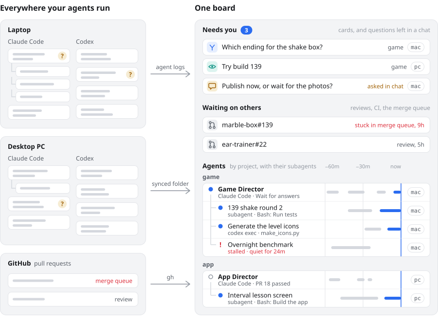
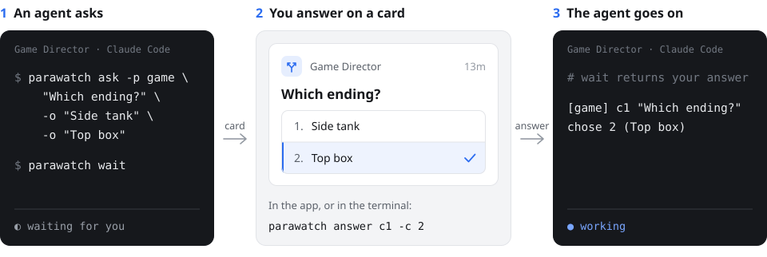
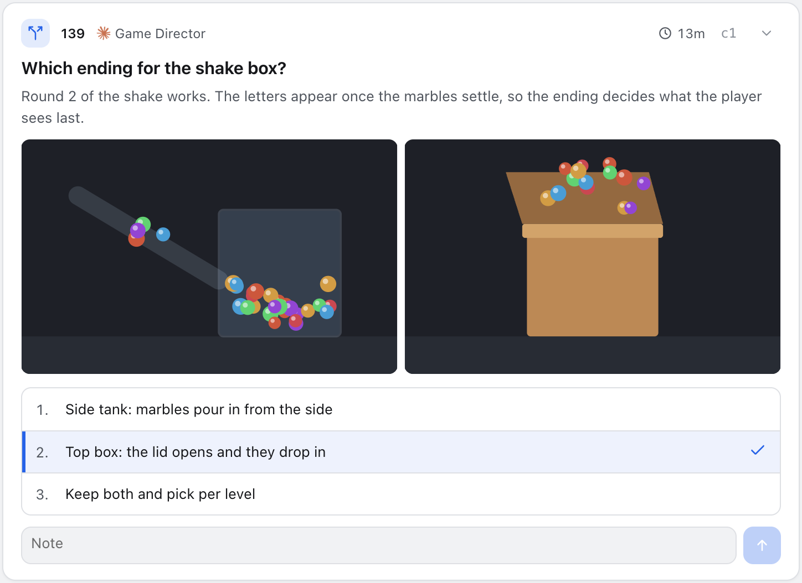
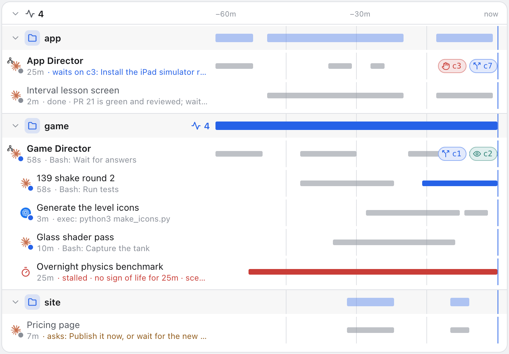

# parawatch

For people who run many Claude Code and Codex sessions, often on more than one machine.

With that many sessions it gets hard to tell which one was which, whether each is still going well, and which ones asked you something that has since scrolled out of sight. parawatch puts all of them on one board.

<picture>
  <source media="(prefers-color-scheme: dark)" srcset="docs/env-dark.svg">
  
</picture>

| | |
|--|--|
| **Which was which** | Sessions by project and task, with their subagents and `codex exec` jobs under them, and the machine each one runs on. |
| **Is it going well** | Working, idle, stalled or failed, what it is doing now, and the last hour as a timeline. |
| **What needs you** | Questions as cards, including ones left in a chat. Your answer goes back to the agent that asked. |
| **What waits on others** | Your pull requests: a review, CI or the merge queue, and for how long. |

It is a CLI and a macOS app. It does not start agents: it reads the logs of the ones you already run. There is no server.

## Install

```
npm install -g parawatch     # the CLI, Node 20 or newer
parawatch skill install      # Claude Code and Codex agents learn the protocol
parawatch status             # what needs you, then what is running
```

The macOS app is on the [latest release](https://github.com/penspanic/parawatch/releases/latest): `arm64` for Apple silicon, `x64` for Intel, signed and notarized. It updates itself.

| | macOS | Linux | Windows |
|--|--|--|--|
| CLI | used daily | tests pass in CI | used daily |
| Desktop app | used daily | no build yet | no build yet |
| Agent logs read | Claude Code, Codex | same | Claude Code; Codex untested |


## More than one machine

parawatch does not move files between machines. Point it at a folder that something else keeps in step (Syncthing, a cloud drive), once on each machine:

```
parawatch sync setup ~/agent-sync/parawatch --device mac --adapter syncthing
parawatch sync setup ~/agent-sync/parawatch --device pc  --adapter syncthing
```

Cards, answers and the list of running sessions then show on every machine, each marked with where it came from. Agent logs stay on the machine that wrote them. The details are in [More than one machine](docs/sync.md).

## How an answer gets back

<picture>
  <source media="(prefers-color-scheme: dark)" srcset="docs/flow-dark.svg">
  
</picture>

Claude Code wakes the moment you answer, because `parawatch wait` runs as a background command of the session. Other runtimes read the answer at their next turn.


## What you see

### Cards

<picture>
  <source media="(prefers-color-scheme: dark)" srcset="docs/card-dark.png">
  
</picture>

| Card | When an agent opens it |
|--|--|
| `decide` | You pick an option or write an answer |
| `try` | You open a build, watch a video or look at a screen |
| `block` | Only you can do it, and the agent is stuck until you do |
| `todo` | Only you can do it, and nothing waits on it now |

### Agents

Every session, its subagents and its `codex exec` jobs, grouped by project, with what each one is doing now. Read from the agents' own logs.

<picture>
  <source media="(prefers-color-scheme: dark)" srcset="docs/agents-dark.png">
  
</picture>

### Pull requests

Read through the GitHub CLI you are already signed in to. Each open pull request shows what it waits on (a review, CI, the merge queue) and for how long. Its news wakes the session that owns it, like an answer.

### In a terminal

```
$ parawatch status
NEEDS YOU  4
  c1   decide   game/139   Which ending for the shake box?                12m
  c2   try      game/139   Try build 139: does the glass read as glass?    4m
  c3   blocked  app        Install the iPad simulator runtime              1h
  c7   decide   app/PR 21  Merge PR 21 and post the 1.4 release note?      9m

ASKED IN CHAT, NO CARD  1  (read from the log)
  Pricing page    6m  Publish it now, or wait for the new photos?  (site)

WAITING ON OTHERS  3 · 1 stuck
  marble-box#139  stuck in merge queue    9h  Game Director           Shake round 2 and the top-box ending
  ear-trainer#22  review (mina)           5h                          Settings screen
  ear-trainer#21  merge                  20m  Interval lesson screen  Interval lessons and the count-in

AGENTS  4 working
app
  ✓ Interval lesson screen (1 PR)    1m  done · PR 21 is green and reviewed; waiting on the merge
  ○ App Director                    24m  PR 18 passed. Waiting for the simulator runtime.
game
  ● Game Director (1 PR)             0s  Bash: Wait for answers
  ├ ● 139 shake round 2              0s  Bash: Run tests
  ├ ● Generate the level icons       2m  exec: python3 make_icons.py
  └ ! Overnight physics benchmark   24m  stalled · no sign of life for 24m · scene 5 of 8
site
  ○ Pricing page                     6m  asks: Publish it now, or wait for the new photos?
```

## Connect a project

```
parawatch init -f AGENTS.md -p game     # or CLAUDE.md
```

This writes a short block that tells the agents in that project to say what they work on, ask on cards and keep one `parawatch wait` armed. The details are in [Agents](docs/agents.md).

## Docs

| | |
|--|--|
| [Commands](docs/commands.md) | What you run: `status`, `cards`, `answer`, `runs`, `pr`, `digest` |
| [Agents](docs/agents.md) | The protocol, the skill, how a session is woken, other runtimes |
| [Pull requests](docs/pull-requests.md) | What is read from GitHub, and its settings |
| [Observed agents](docs/observed-agents.md) | Which logs are read, run states, adding a runtime |
| [More than one machine](docs/sync.md) | Cards and answers across machines through a synced folder |
| [Storage](docs/storage.md) | Where everything is kept, notifications |
| [Installing, updating, removing](docs/install.md) | The three parts in detail, updates, `parawatch doctor`, uninstalling |
| [Building on it](docs/integrations.md) | `status --json`, `watch`, the panel package |

## Not goals

- Starting or steering agents. Use whatever you already use; parawatch only watches and carries answers back.
- A shared team tracker. It is for one person and their agents. It shows other people only as the reviewers your pull requests wait on.
- Replacing your issue tracker. Cards are short-lived questions, not the backlog.

## License

MIT
